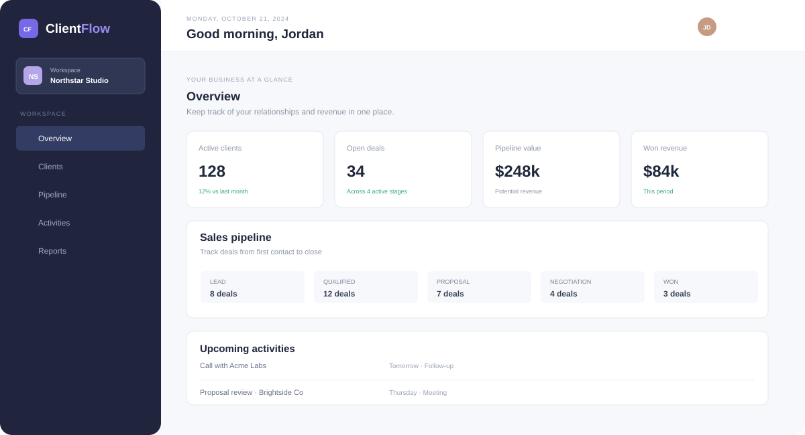
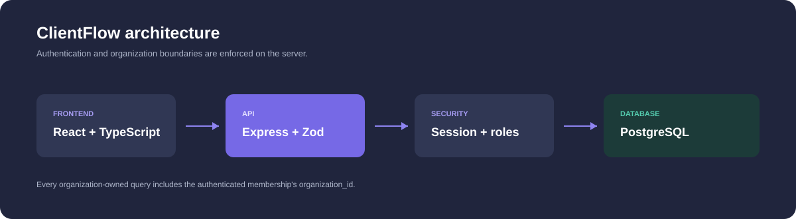

# ClientFlow

ClientFlow is a production-oriented CRM for small teams. It uses a TypeScript React dashboard, an Express API, PostgreSQL, secure HTTP-only sessions, and organization-scoped database queries.





## Features

- Registration, login, logout, current-user session, bcrypt password hashing
- Organization creation on registration and owner/admin/member membership roles
- Tenant-scoped clients with search, pagination, update, and archive behavior
- Deals pipeline with Lead, Qualified, Proposal, Negotiation, Won, and Lost stages
- Activities for calls, meetings, emails, and follow-ups
- Analytics calculated from PostgreSQL records
- Responsive dashboard, pipeline board, client list, activity view, and reports
- PostgreSQL migrations, demo seed data, Docker Compose, and CI workflow

## Architecture

```text
React + TypeScript -> Express + session middleware -> PostgreSQL
                              |                         |
                         Zod validation          organization_id filters
                              |                         |
                         role checks              tenant-scoped records
```

Every request loads the authenticated user's membership from PostgreSQL. Resource queries include that membership's `organization_id`; the client cannot choose an organization and the frontend never performs the isolation filtering. Sessions are stored in PostgreSQL with an HTTP-only, SameSite cookie.

## Local setup

Prerequisites: Node.js 22+, npm, and PostgreSQL available on port `5434`.

```bash
cp server/.env.example server/.env
cp client/.env.example client/.env
npm install
npm --prefix server install
npm --prefix client install
npm --prefix server run migrate
npm --prefix server run seed
npm run dev
```

Open `http://localhost:5173`. The API is at `http://localhost:4300`.

Demo credentials after seeding:

```text
demo@clientflow.local
demo-password
```

## Docker

```bash
docker compose up --build
```

PostgreSQL maps to host port `5434` and stays on `5432` inside Docker. The database uses the persistent `clientflow-pg` volume. The Compose server applies migrations and seeds the demo organization on startup.

## API routes

All routes use `/api/v1` and private routes require the session cookie:

- `GET /health`
- `POST /auth/register`, `POST /auth/login`, `POST /auth/logout`, `GET /auth/me`
- `GET /clients`, `POST /clients`, `PATCH /clients/:id`, `DELETE /clients/:id`
- `GET /deals`, `POST /deals`, `PATCH /deals/:id`
- `GET /activities`, `POST /activities`, `PATCH /activities/:id/complete`
- `GET /analytics`
- `GET /members` for owner/admin roles

JSON errors use `{ "error": { "message": "..." } }`. Client list responses include `data` and `pagination`.

## Checks

```bash
npm test
npm run build
```

The backend smoke tests cover the public health endpoint, anonymous protection, and unknown-route handling. The frontend TypeScript check and Vite production build pass. Full database integration, migration, and cross-tenant tests require PostgreSQL or Docker to be running.

## Security and limitations

Passwords are hashed with bcrypt. Session cookies are HTTP-only, SameSite, and secure in production. Helmet, CORS, rate limiting, Zod validation, role checks, foreign keys, and organization-scoped queries are enabled.

This MVP does not yet include CSRF tokens, invitation emails, password reset, or a full membership-management UI. Same-origin deployment and the configured CORS origin should be used until CSRF protection is added for deployments with cross-site cookie requests. The demo seed is for local development only.
# clientFlow
